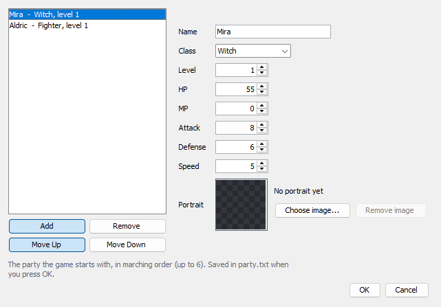

# Walkthrough 2: Party members and enemies in the editor

> **Already applied.** Everything below is already in this project. Read it to learn how the feature works, or use
> it to build the same thing in another codebase.

In this walkthrough you add two windows to the editor, **Project > Party Members** and **Project > Enemies**. In
each one you make, edit and reorder characters, set their stats, and give each a picture of your own.

**Before you start:** do [Walkthrough 1](walkthrough-1-project-folder.md) first. The party and the enemies belong to
the whole game, not to one map, so they're saved in the project folder next to `project.txt`.

## What you'll end up with



The party window: the list on the left, the selected member's details on the right. The enemy window works the same
way.

They're saved as two text files in the project folder, in the same style as the rest of the game's files:

```
; party.txt
[member]
name = Aldric
class = Fighter
level = 3
hp = 42
mp = 0
attack = 11
defense = 9
speed = 5
portrait = assets/aldric.png
```

```
; enemies.txt
[enemy slime]
name = Blue Slime
hp = 12
mp = 0
attack = 4
defense = 2
speed = 3
exp = 5
gold = 2
sprite = assets/blue-slime.png
```

The word after `enemy` is the enemy's **id**. When you add random encounters later, a map will say which enemies
appear by listing ids, like `slime, giant-rat`.

## How it's put together

Three layers, the same split the rest of the engine uses:

| Layer | Classes | Job |
|-------|---------|-----|
| Data (`crawler.core`) | `Stats`, `PartyMember`, `EnemyType` | What a character *is*. No Swing, so the game can use them too. |
| Files (`crawler.core`) | `SectionFile`, `GameData` | Reading and writing `party.txt` and `enemies.txt`. |
| Editor (`crawler.editor`) | `RosterDialog`, `PartyForm`, `EnemyForm`, `StatFields` | The windows. |

The most useful idea here is **`RosterDialog`**. It's one window that edits *any* list: it shows the list,
handles Add / Remove / Move Up / Move Down, OK and Cancel, and asks a small `Form` object to handle the fields.
`PartyForm` and `EnemyForm` are only the parts that differ. Later, items, spells or shops can use the same window
with a new form of their own.

---

## Step 1: Reading and writing section files

Create `src/main/java/crawler/core/SectionFile.java`. It reads and writes `[header]` + `key = value` files, and
reports mistakes with line numbers, so a typo in a hand-edited file says exactly where it is.

```java
package crawler.core;

import java.io.IOException;
import java.nio.charset.StandardCharsets;
import java.nio.file.Files;
import java.nio.file.Path;
import java.util.ArrayList;
import java.util.LinkedHashMap;
import java.util.List;
import java.util.Map;
import java.util.Set;
import java.util.regex.Matcher;
import java.util.regex.Pattern;

/**
 * The plain-text format for game data such as {@code party.txt} and {@code enemies.txt}:
 *
 * <pre>
 * ; comment
 * [enemy slime]
 * name = Blue Slime
 * hp = 12
 * </pre>
 *
 * Each section is a header in square brackets (a kind, then optionally an id) followed by
 * {@code key = value} lines. In values, {@code \n} is a line break.
 */
public final class SectionFile {
    private static final Pattern HEADER = Pattern.compile("\\[\\s*([A-Za-z]+)(?:\\s+([^\\]]*?))?\\s*]");

    private SectionFile() {
    }

    /** One [section] and its values. */
    public record Section(String kind, String id, String source, int line,
                          Map<String, String> values, Map<String, Integer> keyLines) {

        /** A text value, or "" if it isn't there. */
        public String text(String key) {
            return values.getOrDefault(key, "");
        }

        /** An image reference, or null if it isn't there. */
        public String image(String key) {
            String value = values.get(key);
            return value == null || value.isBlank() ? null : value.strip();
        }

        /** A whole number between min and max, or the fallback if it isn't there. */
        public int number(String key, int fallback, int min, int max) {
            String value = values.get(key);
            if (value == null) {
                return fallback;
            }
            try {
                int n = Integer.parseInt(value.strip());
                if (n >= min && n <= max) {
                    return n;
                }
            } catch (NumberFormatException e) {
                // reported below
            }
            throw error(key, key + " should be a whole number from " + min + " to " + max + ", not '" + value + "'");
        }

        /** Fails unless this is a [kind] section, with an id if one is needed. */
        public void expect(String expectedKind, boolean needsId) {
            if (!kind.equals(expectedKind)) {
                throw error(null, "expected [" + expectedKind + (needsId ? " id]" : "]") + ", not [" + kind + "]");
            }
            if (needsId && id == null) {
                throw error(null, "[" + kind + "] needs an id, like [" + kind + " slime]");
            }
            if (!needsId && id != null) {
                throw error(null, "[" + kind + "] doesn't take an id");
            }
        }

        /** Fails if the section has any key not in this list (usually a typo). */
        public void allow(String... keys) {
            Set<String> allowed = Set.of(keys);
            for (String key : values.keySet()) {
                if (!allowed.contains(key)) {
                    throw error(key, "unknown setting '" + key + "' (use " + String.join(", ", keys) + ")");
                }
            }
        }

        /** An error pointing at a key's line, or at the header if key is null. */
        public IllegalArgumentException error(String key, String message) {
            int at = key != null && keyLines.containsKey(key) ? keyLines.get(key) : line;
            return new IllegalArgumentException(source + ", line " + at + ": " + message);
        }
    }

    public static List<Section> read(Path file) throws IOException {
        return parse(file.getFileName().toString(), Files.readAllLines(file, StandardCharsets.UTF_8));
    }

    public static List<Section> parse(String source, List<String> lines) {
        List<Section> sections = new ArrayList<>();
        Section current = null;
        for (int i = 0; i < lines.size(); i++) {
            String line = lines.get(i).strip();
            if (i == 0 && line.startsWith("")) {
                line = line.substring(1);
            }
            if (line.isEmpty() || line.startsWith(";")) {
                continue;
            }
            if (line.startsWith("[")) {
                Matcher m = HEADER.matcher(line);
                if (!m.matches()) {
                    throw new IllegalArgumentException(source + ", line " + (i + 1) + ": expected a header like [enemy slime]");
                }
                String id = m.group(2) == null || m.group(2).isBlank() ? null : m.group(2).strip();
                current = new Section(m.group(1).toLowerCase(), id, source, i + 1, new LinkedHashMap<>(), new LinkedHashMap<>());
                sections.add(current);
                continue;
            }
            if (current == null) {
                throw new IllegalArgumentException(source + ", line " + (i + 1) + ": expected a header like [enemy slime] first");
            }
            int eq = line.indexOf('=');
            if (eq <= 0) {
                throw new IllegalArgumentException(source + ", line " + (i + 1) + ": expected 'key = value'");
            }
            String key = line.substring(0, eq).strip().toLowerCase();
            if (current.values().containsKey(key)) {
                throw new IllegalArgumentException(source + ", line " + (i + 1) + ": '" + key + "' is given twice");
            }
            current.values().put(key, MapLoader.unescape(line.substring(eq + 1).strip()));
            current.keyLines().put(key, i + 1);
        }
        return sections;
    }

    /** Builds the text of a section file. */
    public static final class Writer {
        private final StringBuilder out = new StringBuilder();

        /** Comment lines at the top of the file. */
        public Writer comment(String text) {
            for (String line : text.split("\n")) {
                out.append("; ").append(line).append('\n');
            }
            return this;
        }

        public Writer section(String kind, String id) {
            out.append('\n').append('[').append(kind);
            if (id != null) {
                out.append(' ').append(id);
            }
            out.append("]\n");
            return this;
        }

        /** Writes {@code key = value}; empty and null values are left out. */
        public Writer field(String key, Object value) {
            if (value != null && !value.toString().isBlank()) {
                out.append(key).append(" = ").append(MapWriter.escape(value.toString())).append('\n');
            }
            return this;
        }

        public void save(Path file) throws IOException {
            Files.writeString(file, out.toString(), StandardCharsets.UTF_8);
        }

        @Override
        public String toString() {
            return out.toString();
        }
    }
}
```

`SectionFile` reuses the map format's line-break handling (`MapLoader.unescape` and `MapWriter.escape`). Both are
package-private, and this class is in the same package, so it can use them.

## Step 2: The data classes

These are Java **records**: small immutable classes where Java writes the constructor, getters, `equals` and
`toString` for you. To "change" one, you make a new one; that's what the `with...` methods do.

`Stats` is shared by party members and enemies, so the stat fields only exist once.
Create `src/main/java/crawler/core/Stats.java`:

```java
package crawler.core;

/** The numbers that describe a fighter, shared by party members and enemies. */
public record Stats(int hp, int mp, int attack, int defense, int speed) {
    public static final int MAX_POINTS = 9999;
    public static final int MAX_RATING = 999;

    /** Reads hp, mp, attack, defense and speed from a section, using {@code fallback} for any left out. */
    static Stats read(SectionFile.Section section, Stats fallback) {
        return new Stats(
                section.number("hp", fallback.hp(), 1, MAX_POINTS),
                section.number("mp", fallback.mp(), 0, MAX_POINTS),
                section.number("attack", fallback.attack(), 0, MAX_RATING),
                section.number("defense", fallback.defense(), 0, MAX_RATING),
                section.number("speed", fallback.speed(), 0, MAX_RATING));
    }

    void write(SectionFile.Writer out) {
        out.field("hp", hp).field("mp", mp).field("attack", attack).field("defense", defense).field("speed", speed);
    }
}
```

Create `src/main/java/crawler/core/PartyMember.java`. The record component is `characterClass`, because `class` is
a reserved word in Java. In the file it's still written `class = Fighter`.

```java
package crawler.core;

/**
 * One of the adventurers in the party.
 *
 * @param characterClass Fighter, Mage and so on; any text (the game doesn't use it yet)
 * @param portrait       image reference relative to the project folder, or null
 */
public record PartyMember(String name, String characterClass, int level, Stats stats, String portrait) {
    public static final Stats DEFAULT_STATS = new Stats(30, 0, 8, 6, 5);

    public PartyMember {
        name = name == null ? "" : name.strip();
        characterClass = characterClass == null ? "" : characterClass.strip();
        portrait = portrait == null || portrait.isBlank() ? null : portrait.strip();
    }

    /** A level 1 fighter with the default stats. */
    public static PartyMember create(String name) {
        return new PartyMember(name, "Fighter", 1, DEFAULT_STATS, null);
    }

    public PartyMember withPortrait(String newPortrait) {
        return new PartyMember(name, characterClass, level, stats, newPortrait);
    }
}
```

Create `src/main/java/crawler/core/EnemyType.java`. It's called `EnemyType`, not `Enemy`, because it describes a
*kind* of enemy: a fight against three slimes uses one `EnemyType` three times.

```java
package crawler.core;

import java.util.Locale;

/**
 * A kind of enemy. Encounters will refer to it by its id, such as {@code slime}.
 *
 * @param exp    experience the party earns for beating one
 * @param gold   gold it drops
 * @param sprite image reference relative to the project folder, or null
 */
public record EnemyType(String id, String name, Stats stats, int exp, int gold, String sprite) {
    public static final Stats DEFAULT_STATS = new Stats(12, 0, 4, 2, 3);

    public EnemyType {
        id = id == null ? "" : id.strip();
        name = name == null ? "" : name.strip();
        sprite = sprite == null || sprite.isBlank() ? null : sprite.strip();
    }

    public static EnemyType create(String id, String name) {
        return new EnemyType(id, name, DEFAULT_STATS, 5, 3, null);
    }

    /** Ids are lower-case letters, digits, dashes and underscores, like {@code giant-rat}. */
    public static boolean isValidId(String id) {
        return id.matches("[a-z0-9][a-z0-9_-]*");
    }

    /** An id made from a name: "Giant Rat" gives "giant-rat". */
    public static String idFor(String name) {
        String id = name.toLowerCase(Locale.ROOT).replaceAll("[^a-z0-9]+", "-").replaceAll("^-+|-+$", "");
        return id.isEmpty() ? "enemy" : id;
    }

    public EnemyType withSprite(String newSprite) {
        return new EnemyType(id, name, stats, exp, gold, newSprite);
    }
}
```

## Step 3: Loading and saving the files

Create `src/main/java/crawler/core/GameData.java`:

```java
package crawler.core;

import java.io.IOException;
import java.nio.file.Files;
import java.nio.file.Path;
import java.util.ArrayList;
import java.util.HashSet;
import java.util.List;
import java.util.Set;

/**
 * Game-wide data kept in the project folder next to project.txt: the party the game
 * starts with ({@code party.txt}) and the kinds of enemy ({@code enemies.txt}).
 * A missing file just means there are none yet.
 */
public final class GameData {
    public static final String PARTY_FILE = "party.txt";
    public static final String ENEMIES_FILE = "enemies.txt";
    public static final int MAX_PARTY = 6;
    private static final int MAX_REWARD = 999_999;

    private GameData() {
    }

    public static List<PartyMember> loadParty(Path projectRoot) throws IOException {
        Path file = projectRoot.resolve(PARTY_FILE);
        List<PartyMember> party = new ArrayList<>();
        if (!Files.exists(file)) {
            return party;
        }
        for (SectionFile.Section s : SectionFile.read(file)) {
            s.expect("member", false);
            s.allow("name", "class", "level", "hp", "mp", "attack", "defense", "speed", "portrait");
            party.add(new PartyMember(s.text("name"), s.text("class"), s.number("level", 1, 1, 99),
                    Stats.read(s, PartyMember.DEFAULT_STATS), s.image("portrait")));
        }
        if (party.size() > MAX_PARTY) {
            throw new IllegalArgumentException(PARTY_FILE + ": a party has at most " + MAX_PARTY + " members");
        }
        return party;
    }

    public static void saveParty(Path projectRoot, List<PartyMember> party) throws IOException {
        SectionFile.Writer out = new SectionFile.Writer()
                .comment("The party the game starts with, in marching order.\n"
                        + "Image paths are relative to the project folder.");
        for (PartyMember member : party) {
            out.section("member", null)
                    .field("name", member.name())
                    .field("class", member.characterClass())
                    .field("level", member.level());
            member.stats().write(out);
            out.field("portrait", member.portrait());
        }
        out.save(projectRoot.resolve(PARTY_FILE));
    }

    public static List<EnemyType> loadEnemies(Path projectRoot) throws IOException {
        Path file = projectRoot.resolve(ENEMIES_FILE);
        List<EnemyType> enemies = new ArrayList<>();
        if (!Files.exists(file)) {
            return enemies;
        }
        Set<String> ids = new HashSet<>();
        for (SectionFile.Section s : SectionFile.read(file)) {
            s.expect("enemy", true);
            s.allow("name", "hp", "mp", "attack", "defense", "speed", "exp", "gold", "sprite");
            if (!EnemyType.isValidId(s.id())) {
                throw s.error(null, "'" + s.id() + "' isn't a valid id: use lower-case letters, digits and dashes");
            }
            if (!ids.add(s.id())) {
                throw s.error(null, "there are two enemies with the id '" + s.id() + "'");
            }
            enemies.add(new EnemyType(s.id(), s.text("name"), Stats.read(s, EnemyType.DEFAULT_STATS),
                    s.number("exp", 0, 0, MAX_REWARD), s.number("gold", 0, 0, MAX_REWARD), s.image("sprite")));
        }
        return enemies;
    }

    public static void saveEnemies(Path projectRoot, List<EnemyType> enemies) throws IOException {
        SectionFile.Writer out = new SectionFile.Writer()
                .comment("The kinds of enemy in the game. Encounters refer to them by the id in brackets.\n"
                        + "Image paths are relative to the project folder.");
        for (EnemyType enemy : enemies) {
            out.section("enemy", enemy.id()).field("name", enemy.name());
            enemy.stats().write(out);
            out.field("exp", enemy.exp()).field("gold", enemy.gold()).field("sprite", enemy.sprite());
        }
        out.save(projectRoot.resolve(ENEMIES_FILE));
    }
}
```

Two choices worth knowing about:

- **A missing file means "none yet"**, not an error, so a brand-new project needs no extra files.
- **`allow(...)` rejects unknown settings.** If someone types `strenght = 5` by hand, they get
  `party.txt, line 7: unknown setting 'strenght'` instead of the value being silently ignored.

## Step 4: Two small changes to existing editor classes

**4a. `ImagePicker` must show a different picture for each character.** In
`src/main/java/crawler/editor/ImagePicker.java`, the `set` method is private. Make it package-private so the forms
can call it. Replace

```java
    private void set(String newReference) {
```

with

```java
    /** Shows another image (null = the built-in look), for forms that edit one thing after another. */
    void set(String newReference) {
```

In the constructor, right after `choose.addActionListener(e -> choose());`, add the lines below. Characters have no
built-in picture, so "Use built-in" would make no sense for them:

```java
        if (defaultImage == null) {
            useDefault.setText("Remove image"); // there's no built-in picture to go back to
        }
```

**4b. `AssetStore` must save pictures that aren't on a map.** In `src/main/java/crawler/editor/AssetStore.java`, add
`import java.util.Collection;` and split `saveImages` in two. Replace

```java
    Map<String, String> saveImages(DungeonMap map, Path target) throws IOException {
        Map<String, String> renamed = new LinkedHashMap<>();
        for (String reference : map.assetReferences()) {
```

with

```java
    Map<String, String> saveImages(DungeonMap map, Path target) throws IOException {
        return saveImages(map.assetReferences(), target);
    }

    /** The same for any list of image references, such as party portraits and enemy images. */
    Map<String, String> saveImages(Collection<String> references, Path target) throws IOException {
        Map<String, String> renamed = new LinkedHashMap<>();
        for (String reference : references) {
```

The rest of the method stays as it is.

## Step 5: The list window

Create `src/main/java/crawler/editor/RosterDialog.java`:

```java
package crawler.editor;

import javax.swing.BorderFactory;
import javax.swing.DefaultListCellRenderer;
import javax.swing.DefaultListModel;
import javax.swing.JButton;
import javax.swing.JComponent;
import javax.swing.JDialog;
import javax.swing.JList;
import javax.swing.JOptionPane;
import javax.swing.JPanel;
import javax.swing.JScrollPane;
import javax.swing.KeyStroke;
import javax.swing.ListSelectionModel;
import javax.swing.SwingUtilities;
import java.awt.BorderLayout;
import java.awt.Component;
import java.awt.Container;
import java.awt.Dimension;
import java.awt.FlowLayout;
import java.awt.GridLayout;
import java.awt.event.KeyEvent;
import java.util.ArrayList;
import java.util.Collections;
import java.util.List;

/**
 * Edits a list of things, such as the party or the kinds of enemy: the list on the left,
 * a form for the selected one on the right, and Add / Remove / Up / Down buttons. It works
 * on a copy, so Cancel throws every change away.
 */
final class RosterDialog {
    /** The part that knows about one kind of thing. */
    interface Form<T> {
        /** The fields, laid out and ready to go in the dialog. */
        JComponent component();

        /** Fills the fields from an item. */
        void show(T item);

        /** The item as the fields describe it now. */
        T read();

        /** A new item for the Add button, given the ones already in the list. */
        T create(List<T> items);

        /** How an item appears in the list. */
        String label(T item);

        /** What's wrong with the list, which stops OK, or null if it's fine. */
        default String problem(List<T> items) {
            return null;
        }
    }

    private RosterDialog() {
    }

    /** Shows the dialog; returns the edited list, or null if cancelled. */
    static <T> List<T> show(Component parent, String title, String note, List<T> items, Form<T> form, int maxItems) {
        DefaultListModel<T> model = new DefaultListModel<>();
        items.forEach(model::addElement);
        JList<T> list = new JList<>(model);
        list.setSelectionMode(ListSelectionModel.SINGLE_SELECTION);
        list.setVisibleRowCount(14);
        DefaultListCellRenderer renderer = new DefaultListCellRenderer();
        list.setCellRenderer((l, item, index, selected, focused) ->
                renderer.getListCellRendererComponent(l, form.label(item), index, selected, focused));

        // The form shows one item at a time. Before the selection moves, its edits are written back.
        int[] shown = {-1};
        Runnable keepEdits = () -> {
            if (shown[0] >= 0 && shown[0] < model.size()) {
                model.set(shown[0], form.read());
            }
        };
        Runnable showSelected = () -> {
            int index = list.getSelectedIndex();
            shown[0] = index;
            setEnabledDeep(form.component(), index >= 0);
            if (index >= 0) {
                form.show(model.get(index));
            }
        };
        list.addListSelectionListener(e -> {
            if (!e.getValueIsAdjusting()) {
                keepEdits.run();
                showSelected.run();
            }
        });

        JButton add = new JButton("Add");
        JButton remove = new JButton("Remove");
        JButton up = new JButton("Move Up");
        JButton down = new JButton("Move Down");
        add.addActionListener(e -> {
            keepEdits.run();
            if (model.size() >= maxItems) {
                JOptionPane.showMessageDialog(list, "There can be at most " + maxItems + ".");
                return;
            }
            model.addElement(form.create(Collections.list(model.elements())));
            list.setSelectedIndex(model.size() - 1);
        });
        remove.addActionListener(e -> {
            int index = list.getSelectedIndex();
            if (index < 0) {
                return;
            }
            shown[0] = -1; // it's going: don't write the form back into it
            model.remove(index);
            list.setSelectedIndex(Math.min(index, model.size() - 1));
            showSelected.run();
        });
        up.addActionListener(e -> move(list, model, keepEdits, shown, -1));
        down.addActionListener(e -> move(list, model, keepEdits, shown, 1));

        JPanel buttons = new JPanel(new GridLayout(2, 2, 4, 4));
        buttons.add(add);
        buttons.add(remove);
        buttons.add(up);
        buttons.add(down);
        JScrollPane scroll = new JScrollPane(list);
        scroll.setPreferredSize(new Dimension(230, 300));
        JPanel left = new JPanel(new BorderLayout(0, 6));
        left.add(scroll, BorderLayout.CENTER);
        left.add(buttons, BorderLayout.SOUTH);

        JDialog dialog = new JDialog(SwingUtilities.getWindowAncestor(parent), title, JDialog.ModalityType.APPLICATION_MODAL);
        List<List<T>> result = new ArrayList<>();
        JButton ok = new JButton("OK");
        JButton cancel = new JButton("Cancel");
        ok.addActionListener(e -> {
            keepEdits.run();
            List<T> edited = Collections.list(model.elements());
            String problem = form.problem(edited);
            if (problem != null) {
                JOptionPane.showMessageDialog(dialog, problem, title, JOptionPane.WARNING_MESSAGE);
                return;
            }
            result.add(edited);
            dialog.dispose();
        });
        cancel.addActionListener(e -> dialog.dispose());
        dialog.getRootPane().registerKeyboardAction(e -> dialog.dispose(),
                KeyStroke.getKeyStroke(KeyEvent.VK_ESCAPE, 0), JComponent.WHEN_IN_FOCUSED_WINDOW);

        JPanel bottom = new JPanel(new BorderLayout());
        bottom.add(ObjectDialog.hint(note), BorderLayout.CENTER);
        JPanel okCancel = new JPanel(new FlowLayout(FlowLayout.RIGHT));
        okCancel.add(ok);
        okCancel.add(cancel);
        bottom.add(okCancel, BorderLayout.SOUTH);

        JPanel content = new JPanel(new BorderLayout(14, 10));
        content.setBorder(BorderFactory.createEmptyBorder(12, 12, 8, 12));
        content.add(left, BorderLayout.WEST);
        content.add(form.component(), BorderLayout.CENTER);
        content.add(bottom, BorderLayout.SOUTH);
        dialog.setContentPane(content);

        if (model.isEmpty()) {
            showSelected.run();
        } else {
            list.setSelectedIndex(0);
        }
        dialog.pack();
        dialog.setLocationRelativeTo(parent);
        dialog.setVisible(true); // waits here until OK or Cancel
        return result.isEmpty() ? null : result.get(0);
    }

    private static <T> void move(JList<T> list, DefaultListModel<T> model, Runnable keepEdits, int[] shown, int delta) {
        int from = list.getSelectedIndex();
        int to = from + delta;
        if (from < 0 || to < 0 || to >= model.size()) {
            return;
        }
        keepEdits.run();
        T item = model.get(from);
        model.set(from, model.get(to));
        model.set(to, item);
        shown[0] = -1; // both items are already up to date
        list.setSelectedIndex(to);
    }

    private static void setEnabledDeep(Component component, boolean enabled) {
        component.setEnabled(enabled);
        if (component instanceof Container container) {
            for (Component child : container.getComponents()) {
                setEnabledDeep(child, enabled);
            }
        }
    }
}
```

The tricky part is keeping the form and the list in step. The form only ever shows one item. Its index is kept in
`shown[0]`. Before the selection moves, `keepEdits` writes the form back into that slot, so nothing you typed is
lost when you click another name. When an item is removed or moved, `shown[0]` is set to `-1` first, so the form
isn't written into the wrong slot.

It's a real `JDialog`, not a `JOptionPane`, so OK can *refuse* to close: `problem()` can say
"Two enemies have the id 'rat'" and keep the window open while you fix it.

## Step 6: The forms

Create `src/main/java/crawler/editor/StatFields.java`. Both forms use it for the five stat boxes.

```java
package crawler.editor;

import crawler.core.Stats;

import javax.swing.JComponent;
import javax.swing.JLabel;
import javax.swing.JSpinner;
import javax.swing.SpinnerNumberModel;
import java.text.ParseException;

/** Number boxes for HP, MP, attack, defense and speed, shared by the party and enemy forms. */
final class StatFields {
    private final JSpinner hp = spinner(1, Stats.MAX_POINTS);
    private final JSpinner mp = spinner(0, Stats.MAX_POINTS);
    private final JSpinner attack = spinner(0, Stats.MAX_RATING);
    private final JSpinner defense = spinner(0, Stats.MAX_RATING);
    private final JSpinner speed = spinner(0, Stats.MAX_RATING);

    /** Label / field pairs, for {@link MapDialogs#form}. */
    JComponent[] rows() {
        return new JComponent[]{
                new JLabel("HP"), hp,
                new JLabel("MP"), mp,
                new JLabel("Attack"), attack,
                new JLabel("Defense"), defense,
                new JLabel("Speed"), speed};
    }

    void show(Stats stats) {
        hp.setValue(stats.hp());
        mp.setValue(stats.mp());
        attack.setValue(stats.attack());
        defense.setValue(stats.defense());
        speed.setValue(stats.speed());
    }

    Stats read() {
        return new Stats(value(hp), value(mp), value(attack), value(defense), value(speed));
    }

    static JSpinner spinner(int min, int max) {
        JSpinner spinner = new JSpinner(new SpinnerNumberModel(min, min, max, 1));
        ((JSpinner.DefaultEditor) spinner.getEditor()).getTextField().setColumns(6);
        return spinner;
    }

    /** The number in a box, including one typed but not yet confirmed with Enter. */
    static int value(JSpinner spinner) {
        try {
            spinner.commitEdit();
        } catch (ParseException e) {
            // Not a number: keep the last good value.
        }
        return (Integer) spinner.getValue();
    }
}
```

`value()` calls `commitEdit()` first. Without it, a number you typed but didn't confirm with Enter would be lost
when you pressed OK, a classic Swing trap.

Create `src/main/java/crawler/editor/PartyForm.java`. The Class box is *editable*: pick Fighter, Mage, Priest or Thief,
or type your own.

```java
package crawler.editor;

import crawler.core.PartyMember;

import javax.swing.JComboBox;
import javax.swing.JComponent;
import javax.swing.JLabel;
import javax.swing.JSpinner;
import javax.swing.JTextField;
import java.util.ArrayList;
import java.util.List;

/** The fields for one party member, for {@link RosterDialog}. */
final class PartyForm implements RosterDialog.Form<PartyMember> {
    private static final String[] CLASSES = {"Fighter", "Mage", "Priest", "Thief"};

    private final JTextField name = new JTextField(18);
    private final JComboBox<String> characterClass = new JComboBox<>(CLASSES);
    private final JSpinner level = StatFields.spinner(1, 99);
    private final StatFields stats = new StatFields();
    private final ImagePicker portrait;
    private final JComponent component;

    PartyForm(AssetStore assets) {
        characterClass.setEditable(true); // pick one, or type your own
        portrait = new ImagePicker(assets, null, null, "No portrait yet");
        List<JComponent> rows = new ArrayList<>(List.of(
                new JLabel("Name"), name,
                new JLabel("Class"), characterClass,
                new JLabel("Level"), level));
        rows.addAll(List.of(stats.rows()));
        rows.addAll(List.of(new JLabel("Portrait"), portrait));
        component = MapDialogs.form(rows.toArray(new JComponent[0]));
    }

    @Override
    public JComponent component() {
        return component;
    }

    @Override
    public void show(PartyMember member) {
        name.setText(member.name());
        characterClass.setSelectedItem(member.characterClass());
        level.setValue(member.level());
        stats.show(member.stats());
        portrait.set(member.portrait());
    }

    @Override
    public PartyMember read() {
        String typedClass = String.valueOf(characterClass.getEditor().getItem());
        return new PartyMember(name.getText(), typedClass, StatFields.value(level), stats.read(), portrait.reference());
    }

    @Override
    public PartyMember create(List<PartyMember> party) {
        return PartyMember.create("Adventurer " + (party.size() + 1));
    }

    @Override
    public String label(PartyMember member) {
        String shownName = member.name().isEmpty() ? "(no name)" : member.name();
        return shownName + "  -  " + member.characterClass() + ", level " + member.level();
    }

    @Override
    public String problem(List<PartyMember> party) {
        for (PartyMember member : party) {
            if (member.name().isEmpty()) {
                return "Every party member needs a name.";
            }
        }
        return null;
    }
}
```

Create `src/main/java/crawler/editor/EnemyForm.java`. Leave the Id box empty and one is made from the name
("Giant Rat" becomes `giant-rat`).

```java
package crawler.editor;

import crawler.core.EnemyType;

import javax.swing.JComponent;
import javax.swing.JLabel;
import javax.swing.JSpinner;
import javax.swing.JTextField;
import java.util.ArrayList;
import java.util.HashSet;
import java.util.List;
import java.util.Set;

/** The fields for one kind of enemy, for {@link RosterDialog}. */
final class EnemyForm implements RosterDialog.Form<EnemyType> {
    private final JTextField id = new JTextField(14);
    private final JTextField name = new JTextField(18);
    private final StatFields stats = new StatFields();
    private final JSpinner exp = StatFields.spinner(0, 999_999);
    private final JSpinner gold = StatFields.spinner(0, 999_999);
    private final ImagePicker sprite;
    private final JComponent component;

    EnemyForm(AssetStore assets) {
        id.setToolTipText("How encounters refer to this enemy. Leave empty to make one from the name.");
        sprite = new ImagePicker(assets, null, null, "No image yet");
        List<JComponent> rows = new ArrayList<>(List.of(
                new JLabel("Name"), name,
                new JLabel("Id"), id));
        rows.addAll(List.of(stats.rows()));
        rows.addAll(List.of(
                new JLabel("Experience"), exp,
                new JLabel("Gold"), gold,
                new JLabel("Image"), sprite));
        component = MapDialogs.form(rows.toArray(new JComponent[0]));
    }

    @Override
    public JComponent component() {
        return component;
    }

    @Override
    public void show(EnemyType enemy) {
        id.setText(enemy.id());
        name.setText(enemy.name());
        stats.show(enemy.stats());
        exp.setValue(enemy.exp());
        gold.setValue(enemy.gold());
        sprite.set(enemy.sprite());
    }

    @Override
    public EnemyType read() {
        String typedId = id.getText().strip();
        if (typedId.isEmpty()) {
            typedId = EnemyType.idFor(name.getText());
        }
        return new EnemyType(typedId, name.getText(), stats.read(),
                StatFields.value(exp), StatFields.value(gold), sprite.reference());
    }

    @Override
    public EnemyType create(List<EnemyType> enemies) {
        Set<String> taken = new HashSet<>();
        enemies.forEach(e -> taken.add(e.id()));
        String newId = "enemy";
        for (int n = 2; taken.contains(newId); n++) {
            newId = "enemy-" + n;
        }
        return EnemyType.create(newId, "New enemy");
    }

    @Override
    public String label(EnemyType enemy) {
        return (enemy.name().isEmpty() ? "(no name)" : enemy.name()) + "  [" + enemy.id() + "]";
    }

    @Override
    public String problem(List<EnemyType> enemies) {
        Set<String> seen = new HashSet<>();
        for (EnemyType enemy : enemies) {
            if (enemy.name().isEmpty()) {
                return "Every enemy needs a name.";
            }
            if (!EnemyType.isValidId(enemy.id())) {
                return "\"" + enemy.id() + "\" can't be an id. Use lower-case letters, digits and dashes, like giant-rat.";
            }
            if (!seen.add(enemy.id())) {
                return "Two enemies have the id \"" + enemy.id() + "\". Each needs its own.";
            }
        }
        return null;
    }
}
```

## Step 7: Add them to the Project menu

In `src/main/java/crawler/editor/EditorFrame.java`, add these imports with the other `crawler.core` ones:

```java
import crawler.core.EnemyType;
import crawler.core.GameData;
import crawler.core.PartyMember;
```

and this with the `java.util` ones:

```java
import java.util.Objects;
```

In `menuBar()`, after the `Show Project Folder` line from Walkthrough 1, add:

```java
        projectMenu.addSeparator();
        projectMenu.add(projectAction("Party Members...", this::editParty));
        projectMenu.add(projectAction("Enemies...", this::editEnemies));
```

Because they're made with `projectAction`, they're greyed out unless a project is open, with no extra code.

Then add these two methods, for example above `showProjectFolder()`:

```java
    private void editParty() {
        try {
            List<PartyMember> party = GameData.loadParty(project.root());
            List<PartyMember> edited = RosterDialog.show(this, "Party - " + project.name(),
                    "The party the game starts with, in marching order (up to " + GameData.MAX_PARTY + "). "
                            + "Saved in party.txt when you press OK.",
                    party, new PartyForm(assets), GameData.MAX_PARTY);
            if (edited == null) {
                return;
            }
            // Copy any new portraits into the project's assets folder, then save the list.
            Map<String, String> renamed = assets.saveImages(
                    edited.stream().map(PartyMember::portrait).filter(Objects::nonNull).toList(), project.root());
            edited = edited.stream().map(m -> m.withPortrait(renamed.getOrDefault(m.portrait(), m.portrait()))).toList();
            GameData.saveParty(project.root(), edited);
            status("Saved " + edited.size() + " party members in " + GameData.PARTY_FILE + ".");
        } catch (IOException | IllegalArgumentException e) {
            JOptionPane.showMessageDialog(this, "Could not edit the party:\n" + e.getMessage(),
                    APP, JOptionPane.ERROR_MESSAGE);
        }
    }

    private void editEnemies() {
        try {
            List<EnemyType> enemies = GameData.loadEnemies(project.root());
            List<EnemyType> edited = RosterDialog.show(this, "Enemies - " + project.name(),
                    "Every kind of enemy in the game. Encounters will refer to them by id. "
                            + "Saved in enemies.txt when you press OK.",
                    enemies, new EnemyForm(assets), Integer.MAX_VALUE);
            if (edited == null) {
                return;
            }
            Map<String, String> renamed = assets.saveImages(
                    edited.stream().map(EnemyType::sprite).filter(Objects::nonNull).toList(), project.root());
            edited = edited.stream().map(e -> e.withSprite(renamed.getOrDefault(e.sprite(), e.sprite()))).toList();
            GameData.saveEnemies(project.root(), edited);
            status("Saved " + edited.size() + " kinds of enemy in " + GameData.ENEMIES_FILE + ".");
        } catch (IOException | IllegalArgumentException e) {
            JOptionPane.showMessageDialog(this, "Could not edit the enemies:\n" + e.getMessage(),
                    APP, JOptionPane.ERROR_MESSAGE);
        }
    }
```

Each method follows the same four steps: load the file, show the window, copy any new pictures into the project's
`assets` folder, save. The `renamed` lines handle a rare case. If a *different* picture with the same file name
appeared in `assets` while the window was open, the new one is saved under another name, and the character is
updated to match.

Party changes are saved when you press OK. They aren't part of the map's undo history, because they aren't part
of a map.

## Step 8: Try it

1. Build and start the editor (`editor.cmd`) and open your project (**File > Open Project**).
2. Choose **Project > Party Members**, then click **Add**. Rename the member, change the class, type a new HP, pick a
   portrait, and use **Move Up**. Press **OK**.
3. Open the project folder (**Project > Show Project Folder**). `party.txt` lists your party, and the portrait is in
   `assets`.
4. Choose **Project > Enemies** and add a *Giant Rat* with an empty Id box. After OK its id is `giant-rat`.
5. Try to break it. Add two enemies, give both the id `rat`, and press OK. The window refuses and says why.

## Adding a stat later

Say you want **luck**. Every place to change:

1. `Stats`: add `int luck` to the record, then add it to `read` (with a range) and to `write`.
2. `PartyMember.DEFAULT_STATS` and `EnemyType.DEFAULT_STATS`: add a value for it.
3. `GameData`: add `"luck"` to both `allow(...)` lists.
4. `StatFields`: add a spinner, a row, and a line each in `show` and `read`.

The compiler points out every `new Stats(...)` you missed, so you can't forget one.

## What's next: using them in the game

The editor can now make the cast, but the game doesn't use it yet. The next steps, in order:

1. **Load it.** In `Main.load`, call `GameData.loadParty(project.root())` and `loadEnemies(...)`, and pass them to `Game`.
2. **Show the party.** Draw each member's name and HP in `GamePanel`'s status box.
3. **Encounters.** Add an `encounters = slime, giant-rat` setting to maps and roll for a fight in `Game.onMovement`,
   the hook that already runs on every step.
4. **The battle screen.** Draw enemy sprites in the 3D view (the `Sprite` and `Billboard` classes already handle
   pictures) and give each party member a command menu.

## How this was checked

I built every step above in a copy of your project and tested it there; your own project's code wasn't changed.
The automated checks loaded and saved both files, and tried 11 kinds of broken file, each giving the right error
and line number. They also drove both windows: adding, renaming, typing an unconfirmed number, moving, Cancel, and
making an id from a name. They also covered the duplicate-id and missing-name checks that stop OK. Both windows
were screenshotted.
